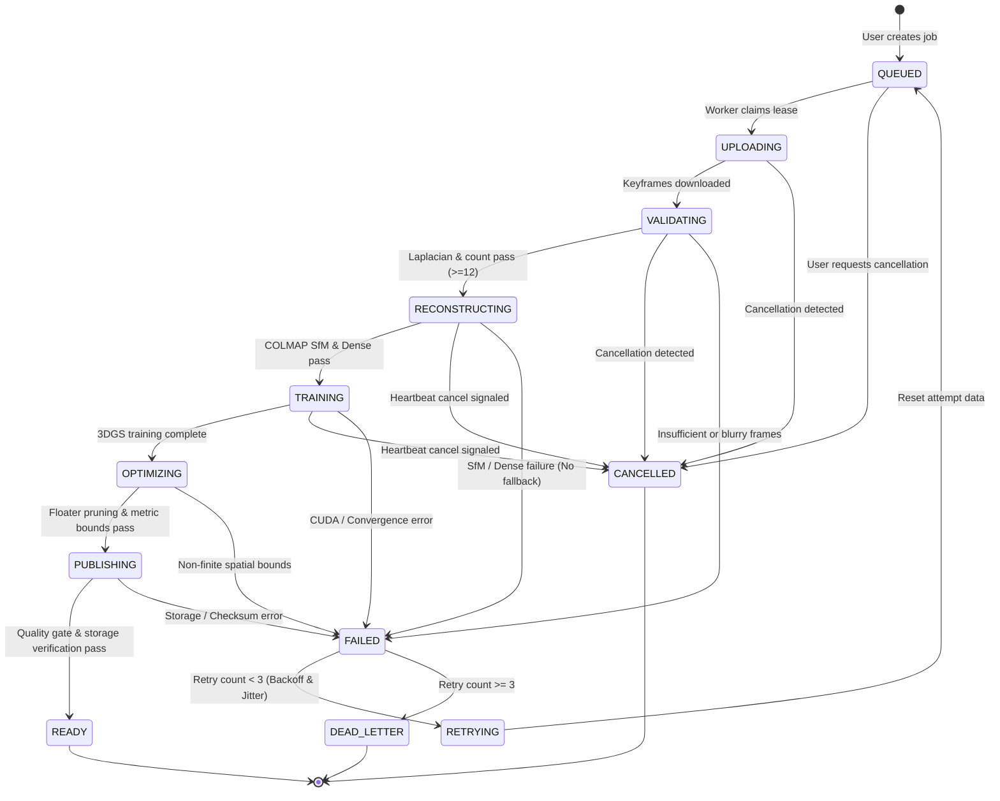

# HETTETY v4 — RECONSTRUCTION JOB STATE MACHINE (Phase 0)

## State Lifecycle Diagram

## State Invariants & Transitions

| From State | To State | Trigger / Condition | Invariant Enforced |
| :--- | :--- | :--- | :--- |
| `QUEUED` | `UPLOADING` | Worker acquires lease | Leased by workerId with 30s TTL; heartbeat starts |
| `UPLOADING` | `VALIDATING` | Files downloaded | Integrity checksums match upload manifest |
| `VALIDATING` | `RECONSTRUCTING` | `validate_keyframes` passed | Count $\ge 12$, average sharpness $> 10$ |
| `RECONSTRUCTING` | `TRAINING` | `run_sfm` + `run_dense` passed | True point cloud generated; sparse fallback prohibited |
| `TRAINING` | `OPTIMIZING` | `run_gaussian_training` passed | Valid PLY with finite coefficients (no NaNs) |
| `OPTIMIZING` | `PUBLISHING` | Floater prune & bounds | Bounding box strictly computed from geometry |
| `PUBLISHING` | `READY` | Artifact promotion | SHA-256 verified, attempt directory immutable |
| Any active | `CANCELLED` | User cancellation | Child processes killed; GPU memory freed |
| Any active | `FAILED` | Pipeline error | Atomic error recording; retry eligibility evaluated |
