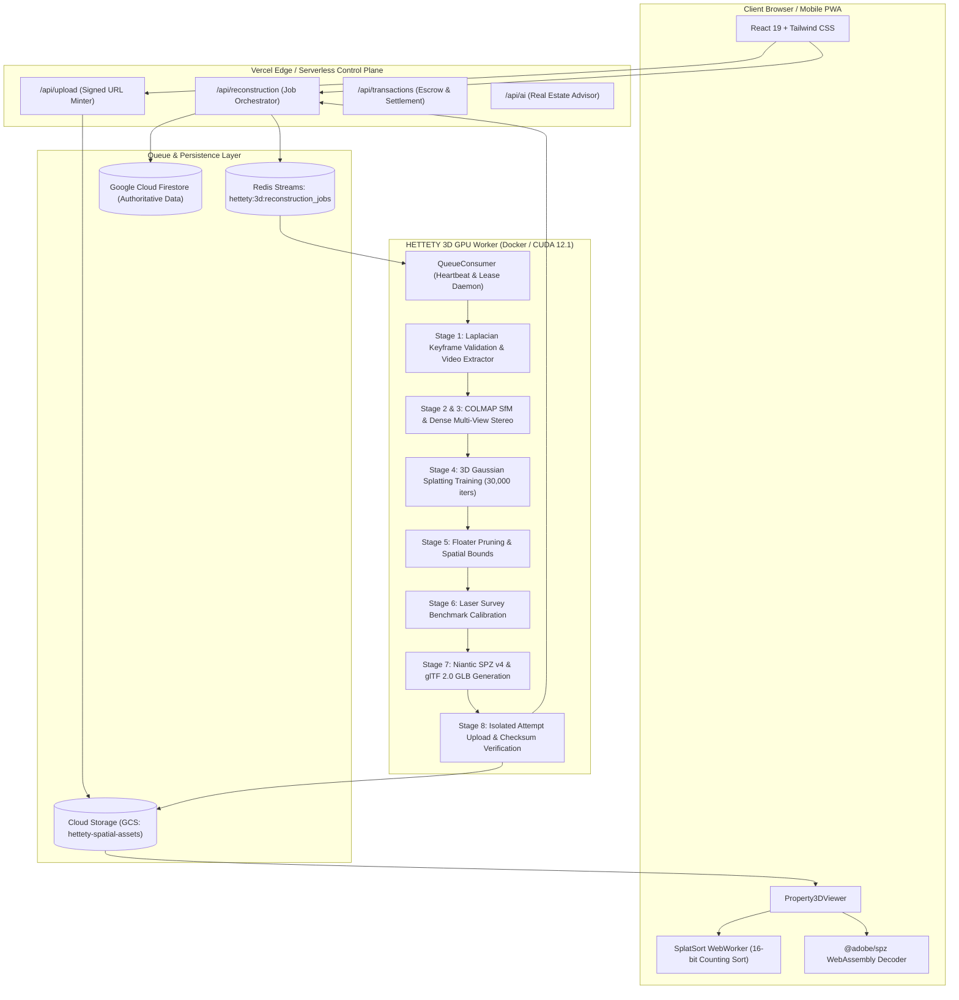

# HETTETY v4 — SYSTEM ARCHITECTURE SPECIFICATION (Phase 0)

## Architectural Component Breakdown

### 1. Frontend Web Client
- **Framework**: React 19, Vite 6, TypeScript 5.8.
- **3D Engine**: Three.js, `@react-three/fiber`, `@react-three/drei`.
- **Custom Shaders**: Gaussian splat point cloud vertex and fragment shaders with view-space covariance projection.
- **Asynchronous Worker**: `splat-sort.worker.ts` computes $O(N)$ draw order on background threads using ArrayBuffer transfer semantics.

### 2. Control Plane API
- **Endpoint**: `/api/reconstruction`.
- **Security**: Strict Bearer token authentication via `WORKER_SHARED_SECRET` in production.
- **Idempotency**: Redis `SET NX` key reservation paired with Redis Stream `XADD` for deduplicated queuing.
- **Transactions**: Atomic promotion of completed attempts in Firestore transactions, preventing split-brain or stale worker overwrites.

### 3. GPU Worker Reconstruction Engine
- **Base Image**: `nvidia/cuda:12.1.1-devel-ubuntu22.04`.
- **Tooling**:
  - COLMAP (CPU/GPU acceleration).
  - Graphdeco 3D Gaussian Splatting pinned at commit `2eee0e2`.
  - Niantic SPZ CLI compiler (version 4 NGSP).
  - OpenCV & Pillow for image validation and video frame extraction.

### 4. Storage Architecture
- **Raw Uploads**: `properties/{propertyId}/uploads/{jobId}/frame_{i}.jpg`
- **Attempt Artifacts (Immutable)**: `properties/{propertyId}/3d/{jobId}/{attemptId}/scene.spz`, `mesh.glb`, `manifest.json`.
- **Public Tour Pointer**: `properties/{propertyId}/tour/scene.spz` (Promoted strictly by the Control Plane after all quality gates pass).
